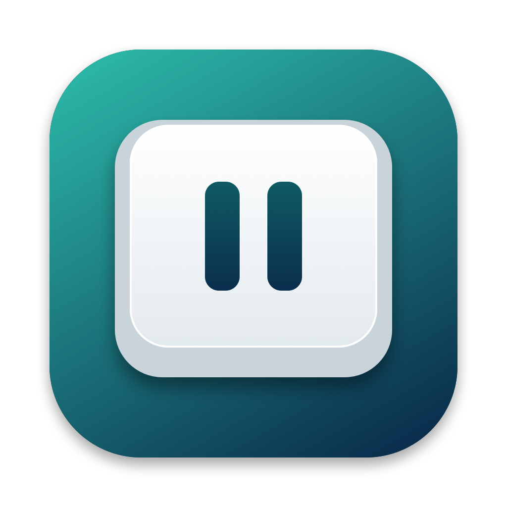
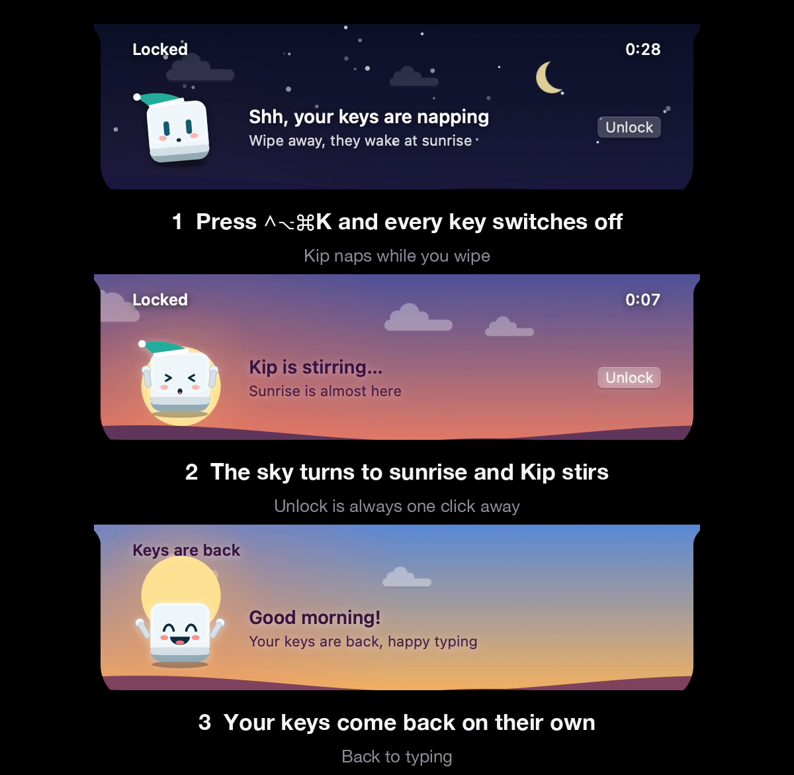

<p align="center">
  
</p>

<h1 align="center">Keypause</h1>

<p align="center">
  <b>Press one button. Wipe your keyboard. Done.</b><br>
  A menu bar app that turns every key off while you clean, then back on.
</p>

<p align="center">
  <a href="https://github.com/destucr/Keypause/releases/latest"></a>
  
  
</p>

<p align="center">
  
</p>

<p align="center"><a href="https://destucr.github.io/Keypause/">Website</a> · <a href="docs/demo.mp4">Watch it move (60 fps video)</a></p>

## Features

- **Every key off**, including shortcuts, function keys and media keys. Mouse and trackpad keep working.
- **Doesn't interrupt you.** A small HUD shows the countdown and an **Unlock** button without stealing focus, so video keeps playing.
- **Starts from anywhere** with `⌃⌥⌘K`, the menu bar, or Terminal.
- **Always ends.** Pick 30 s to 10 min. The keys come back when the timer does.
- **Screen stays awake** while locked.
- **A night that ends in sunrise.** Kip the keycap naps while your keys are off. The sky goes from night to dawn as the timer runs, and he wakes up just before the keys come back. No progress bar.
- **Update checks.** **Check for Updates…** in the menu tells you when a new version is out. Homebrew users get the `brew upgrade` command.
- **Notch-friendly.** On a MacBook with a notch, the HUD grows out of it.

## Install

For Apple silicon Macs (M1 and newer) on macOS 14 or later.

```sh
brew install --cask destucr/tap/keypause
```

Or download `Keypause.dmg` from [Releases](https://github.com/destucr/Keypause/releases/latest) and drag it to Applications.

Keypause isn't notarized (no paid Apple developer account), so after a manual download, right-click → **Open** the first time. Homebrew handles this for you.

On first run, switch Keypause on in **System Settings → Privacy & Security → Accessibility** (called *Device Control and Data Access* on newer macOS). The welcome window has a button that opens it.

## Terminal

```sh
keypause start       # your chosen duration
keypause start 90    # 90 seconds ("90s" and "2m" work too, up to 5 minutes)
keypause stop        # unlock early
keypause check       # check for updates
```

Homebrew installs the `keypause` command for you. If you installed another way:
`ln -s /Applications/Keypause.app/Contents/Resources/keypause /usr/local/bin/keypause`

Raycast and Shortcuts can open `keypause://start` and `keypause://stop`.

## Privacy

Keypause never reads, stores or sends your keystrokes. Its only network request is an update check against this project's public GitHub releases, at most once a day, and it sends nothing about you. Turn it off from the menu (**Check Automatically**). It never installs anything by itself.

## Build

Requires macOS 14+ and Xcode.

```sh
./Scripts/build.sh && open dist/Keypause.app
```

## License

[MIT](LICENSE) © Destu Cikal · [Need help?](docs/HELP.md)
